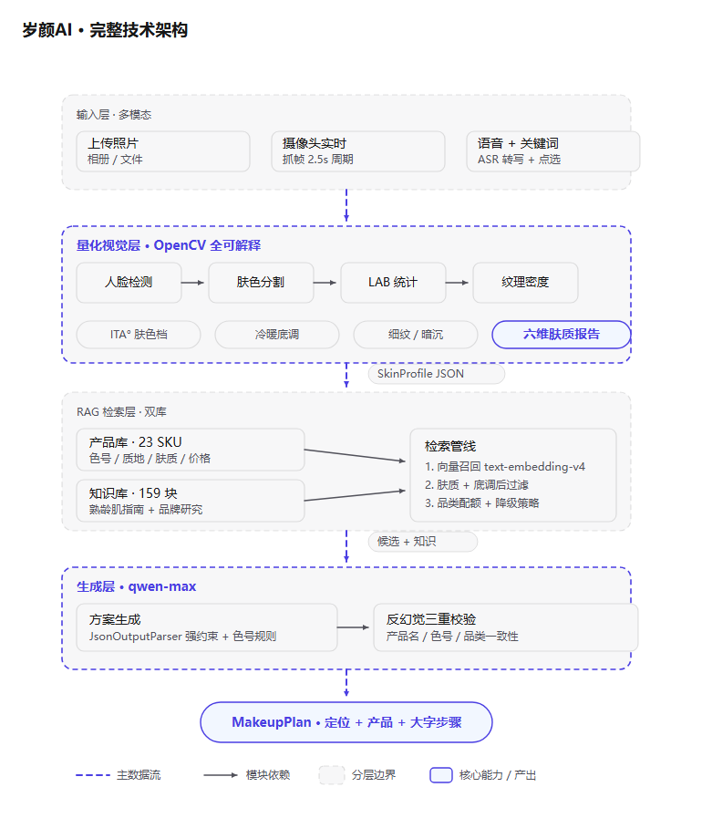

# 岁颜AI · 熟龄肌智能妆容方案 | SuiYan AI

巴黎欧莱雅 · 美妆科技黑客松第二届 · 赛题三参赛作品。

上传/实时拍摄熟龄女性人像 → 视觉算法量化肤质（ITA° 肤色角度 / 底调比 / 纹理密度）→ 肤质报告仪表盘 → 语音或关键词确认需求 → RAG 检索欧莱雅真实产品库 → 生成妆容定位 + 产品搭配（含色号与价格）+ 大字版化妆步骤。

**核心理念：不去皱纹、保留原生特征，只提气色。**



## Architecture

```
Portrait (upload / live camera) / voice + keyword input
   │
   ▼
Vision quantify (OpenCV)          suiyan_vision_utils.py
  · Haar face detection
  · RGB + YCrCb skin mask (brightness-guarded)
  · ITA° = arctan((L*-50)/b*)     CIE LAB, median over skin pixels
  · undertone ratio = b*/a*
  · wrinkle density (Laplacian, calibrated to /35 real-portrait range)
  · _skin_scores: 6 explainable 0-10 dims (luma / glow / evenness /
    smoothness / youth / balance) -> overall ring + radar dashboard
   │  SkinProfile JSON (contract) + scores
   ▼
Filtered RAG retrieval            suiyan_product_store.py
  · vector recall → post-filter by skin type / undertone
  · two-level fallback when filter empties
  · category quota (lip / base always present)
   │  candidate products
   ▼
Plan generation + anti-hallucination   suiyan_chain.py
  · qwen-max + JsonOutputParser
  · voice request arbitration (occasion override, budget note,
    quantified metrics win over speech when conflicting)
  · product must exist in retrieved set
  · shade must belong to that product
  · category consistency check
   │
   ▼
MakeupPlan JSON → Web UI          suiyan_api.py + static/index.html
```

## Features

- **量化肤质分析**：ITA° 肤色角度、b*/a* 底调比、纹理密度，弱光自动告警
- **肤质报告仪表盘**：综合分环形 + 六维雷达（光泽/气色/匀净/细腻/年轻/平衡），每维可溯源至实测值，纯 SVG 零外部依赖
- **实时摄像头检测**：浏览器 `getUserMedia` 每 2.5s 抓帧，指标与报告同步刷新
- **语音需求录入**：浏览器录音 → DashScope qwen3-asr-flash 转写（国内直连）
- **关键词确认**：适老化设计，点选场合/预算/妆感/质地，语音自动预选
- **反幻觉校验**：推荐产品与色号必须来自检索结果，杜绝编造
- **大字版输出**：产品卡（色号徽章/价格/推荐理由）+ 大字号步骤
- **移动端适配**：手机浏览器可用（上传照片 + 关键词点选全流程）

## Quick Start

```bash
pip install -r requirements.txt

# required: DashScope API key (chat, embedding & ASR)
set DASHSCOPE_API_KEY=sk-xxxx

# ingest knowledge + products into Chroma (first run only)
python -c "import suiyan_product_store; suiyan_product_store.ingest_all()"

# serve
python -m uvicorn suiyan_api:app --host 0.0.0.0 --port 8000
```

Open <http://127.0.0.1:8000> — mobile browsers require HTTPS for camera/mic,
so use localhost on desktop for the full experience (upload + keyword flow
still works on mobile LAN).

## Project Layout

```
suiyan_api.py            FastAPI: /vision/analyze /skin-profile/plan /voice/transcribe
suiyan_schemas.py        SkinProfile / Product / MakeupPlan contracts (pydantic)
suiyan_product_store.py  dual-collection Chroma store + filtered retrieval
suiyan_chain.py          LCEL plan chain + anti-hallucination validation
suiyan_vision_utils.py   ITA° / undertone / wrinkle / skin-scores pipeline
suiyan_demo_main.py      offline end-to-end demo (no browser)
data/products.json       23 L'Oréal Paris SKUs (shades/texture/price/fit)
data/knowledge/          curated knowledge corpus (7 txt + Xinhua guide PDF)
static/index.html        single-file frontend (report dashboard + mobile responsive)
rag.py / knowledge_base.py / vector_stores.py   generic QA RAG baseline
```

## API

| Endpoint | Method | Purpose |
|---|---|---|
| `/health` | GET | service & corpus status |
| `/vision/analyze` | POST (multipart) | portrait image → metrics + 6-dim scores + suggested profile |
| `/skin-profile/plan` | POST (json) | SkinProfile → MakeupPlan |
| `/voice/transcribe` | POST (multipart) | webm/mp3 audio → text |
| `/products` | GET | full product catalogue |

## Disclaimer

仅供黑客松演示。产品信息以欧莱雅官方渠道为准；算法量化结果受光照影响，
不构成医学或皮肤学诊断。
